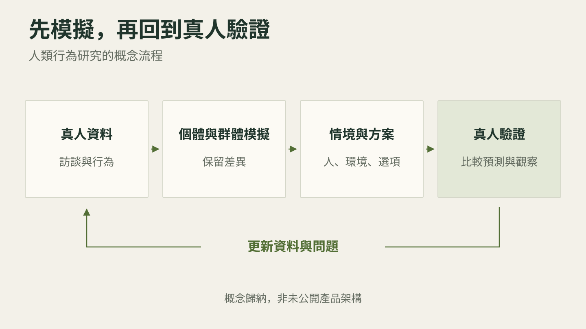
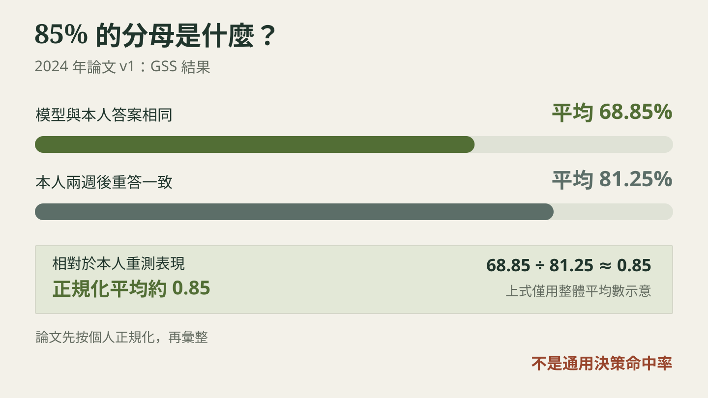

> 本導讀的分析與撰稿由 AI 模型完成，不是人類分析，也沒有經過人工逐句校稿。

*本文歸納：模擬可以把研究提早帶進決策，可信度仍須由真人資料檢驗。這是概念流程，不是 Simile 未公開的產品架構。*

## 產品還沒上市，先問模擬顧客

Simile 的 Itaú 案例文章用一個示意情境，說明研究開始前就會發生的取捨：團隊提出二十個方向，最後只留下三個送測；剩下的十七個，可能只是沒有時間和預算研究。[案例原文](https://www.simile.com/blog/itau-at-esomar)這正是人類行為模擬最值得追問的用途：如果試探一個構想變得便宜，企業是否能在承諾投入資源以前，多看幾條路？

在 2026 年 10 月 26 日上架的訪談中，Sourcery 主持人 Molly O’Shea 訪問 Simile 共同創辦人暨執行長 Joon Sung Park。訪談從「我們是否活在模擬裡」聊起，逐步轉向一項具體生意：以真人資料建立模型，讓企業詢問不同族群，在不同情境下可能如何回應。Park 在 [15:45](https://www.youtube.com/watch?v=-6Kg5N7JL7I&t=945s) 開始說明產品用途，包含問卷、概念測試、聯合分析與更複雜的情境模擬。

這門生意已有資本支持。Simile 在 2026 年 7 月 30 日宣布 B 輪募資超過 2 億美元，投後估值 20 億美元；Index 也公布參與這輪投資。估值是融資條件，不能當成預測能力的驗證。[公司募資公告](https://www.simile.com/blog/series-b)、[Index 投資說明](https://www.indexventures.com/perspectives/simulating-society-at-scale-our-investment-in-similes-200m-series-b/)

**真正需要弄清楚的，是模擬答案能替哪一種決策增加證據。** 一段像人的回答、一個準確的群體分布，以及一項能改善銷售的策略，彼此之間都有距離。

## 先看重點：訪談說法與證據的距離

| 訪談中的焦點 | 可以採取的解讀 | 必須保留的邊界 |
|---|---|---|
| Smallville 的 25 個代理人 | 記憶、反思與規劃可支持連貫互動 | 研究衡量可信感；派對有初始設定 |
| 85% 準確率 | 2024 年研究的 GSS 正規化指標 | 不是所有現實決策的命中率 |
| 4,000 萬真人 | Park 自述合作樣本網路的觸及規模 | 不能寫成已完成 4,000 萬個分身 |
| 每題附信心訊號 | 公司描述用另一模型估計模擬誤差 | 不是 p 值，也不是個人一定會照做的機率 |
| 與 Gallup 合作 | Gallup 正在獨立驗證方法 | Gallup 明言不以模擬取代其追蹤研究真人量測 |

表中研究指標可回溯至下文論文；**合作規模與產品功能則保留為當事方說法**。

## 一座小鎮，先解決角色能不能記得昨天

Smallville 看起來像一個像素遊戲：二十五個角色起床、工作、聊天，也有人相約參加情人節派對。若把每個動作都交給遊戲編劇，這只是另一套預先寫好的劇情。研究團隊想試的是，能否只給角色背景與環境，再讓行為從互動中逐步生成。

關鍵不只在語言模型會說話。模型周圍有一套管理經驗的架構：把發生過的事留下來，依當下問題找出相關記憶，從多次經驗形成較高層的判斷，再規劃下一步。新行動又成為後續的記憶。這讓「我昨天答應了某人」有機會約束今天的行為，而不是每次提問都重新扮演一個失憶角色。[2023 年 Smallville 論文](https://arxiv.org/html/2304.03442)

例如，替朋友挑禮物不能只靠對方出現的次數。角色得記得對方談過什麼，判斷什麼對他重要，再把這個判斷用在新問題上。訪談 [06:46](https://www.youtube.com/watch?v=-6Kg5N7JL7I&t=406s) 開始的評估討論，談的就是如何透過訪問代理人，觀察這些能力有沒有運作。

**角色讓人覺得合理，還不足以證明它代表某個真實的人。** 小鎮研究先跨過的是連貫性與可信感的門檻。原始論文也明說，派對源自一個角色想辦派對的初始設定；邀請如何傳開、誰一起出席，才是後續生成的互動。不能把「沒有逐一編寫所有行動」說成「整場活動沒有任何設定」。

## 從虛構角色到真人，85% 的分母變了

下一步的問題難得多：把某個真人的生活經驗交給模型，能不能預測那個人尚未回答的問題？這要求評估從「旁觀者覺得像不像」轉成「拿本人的答案來比較」。

Park 等人在 2024 年發布的研究，對 1,052 名美國受試者進行約兩小時的質性訪談，建立代表他們的代理人，並以問卷與行為測試比較模擬和真人。本文討論訪談提及的 2024 年初版；同一篇 arXiv 紀錄後續已有修訂，引用時應保留版本。[2024 年論文 v1](https://arxiv.org/abs/2411.10109v1)

為什麼需要問兩次真人？因為同一個人隔兩週填問卷，也不會每題都答得一樣。若要知道模型接近本人到什麼程度，研究者會把真人自己的重答一致性納入比較。

*2024 年論文 v1 的 GSS 結果。圖中以整體平均數相除幫助理解；論文報告的正規化指標以個別受試者計算後彙整。這些數字不代表通用的人生決策命中率。*

| GSS 指標 | 研究報告值 | 回答的問題 |
|---|---|---|
| 模型預測與本人作答相同 | 平均 68.85% | 模型實際對上多少答案？ |
| 本人兩週後重答一致 | 平均 81.25% | 真人自己有多一致？ |
| 正規化準確率 | 平均約 0.85 | 模型相對於本人重測表現如何？ |

這組結果是有價值的研究證據，顯示訪談能為個體模擬提供資訊。但「達到真人重測表現的約 85%」若在標題裡被壓成「預測你的決策，準確率 85%」，**測量任務與分母就一起消失了**。[論文 v1 全文](https://arxiv.org/pdf/2411.10109v1)

**85% 的結論要跟著測試任務走。** 問卷上的態度答案、帶有金錢誘因的行為、明年買不買一輛車，是不同任務；研究本身納入多種測試，不能拿某一項成績套到所有場景。這個數字也不能直接當成 2026 年商業產品每次查詢的準確率。

企業比較該追問的是：這次要研究的客群、問題和選項，跟驗證資料有多接近？如果測試來自美國成年人，換成臺灣的特定消費族群，就需要新的證據支持。這是本文從研究設計推得的使用條件，不是論文已完成的跨市場驗證。

## 人的選擇，還取決於旁邊有哪些路

訪談 [13:40](https://www.youtube.com/watch?v=-6Kg5N7JL7I&t=820s) 把問題拉回生活。一個人說本週願意去健身房，真正到了晚上，他還能多睡一小時、再開一場會，或留在家裡。選擇發生時，其他選項也在場。

買水的例子更清楚。只問「你願意為水付多少錢」，會漏掉附近有沒有其他水源、替代商品的價格，以及當時有多渴。若模擬只抓住人的偏好，卻把替代選項拿掉，得到的價格反應可能根本不適用於現實市場。[17:22](https://www.youtube.com/watch?v=-6Kg5N7JL7I&t=1042s)

換句話說，模型需要同時知道「這是誰」、「面對什麼情境」與「可以做什麼」。這和 Simile 技術文章對輸入的描述一致：族群、情境及有效行動集合，共同決定要模擬的問題。[Simile 信心模型說明](https://www.simile.com/blog/confidence)

**情境設定錯了，更多模擬次數也救不了它。** 假設研究的是漲價後的購買意願，卻沒放進競品價格或退出選項，結果可能在這個封閉設定裡很穩定，實際上回答的卻不是企業原本的問題。這是建模上的限制，不能靠讓模型回答得更流暢來消除。

Park 也談到問卷自述與實際行動的差距。他用不同曲線形狀描述這種落差；本文把它當作他的解釋性比喻，不視為所有人類行為都遵循同一套數學定律。所謂風險偏好不變，也應保留為訪談中的概括說法，不當成對所有人的定論。

## 4,000 萬真人背後，是一門持續取得資料的生意

如果模擬可以反覆提問，為什麼 Simile 還要持續找真人？因為模型不會憑空知道一群新客戶的生活。研究特定銀行的客戶、特定疾病的患者，與模擬一般人口，所需資訊可能不同。

Park 在 [21:31](https://www.youtube.com/watch?v=-6Kg5N7JL7I&t=1291s) 說明，公司先準備產業樣本庫，再依客戶需求補充資料；他提到透過合作樣本網路觸及超過 4,000 萬真人。這是講者對合作規模的自述，**不等於公司已訪談每一個人，也不等於已建立 4,000 萬個經驗證的數位分身。**

這裡的經營難題很具體：找得到人、取得同意、問對問題、辨識低品質回答，再把資料帶回模型。受訪者可能疲勞、敷衍，或為了報酬迎合篩選條件。訪談 [24:22](https://www.youtube.com/watch?v=-6Kg5N7JL7I&t=1462s) 談到參與間隔與注意力檢查；這些方法能處理某些品質問題，卻不能自動保證所有族群都被適當代表。

Park 表示，公司要求知情同意並允許退出，也不蒐集無法提供知情同意者的資料。這是公司的資料治理主張。對客戶而言，仍須核對其實際適用範圍：同意是否涵蓋建立分身、跨題目使用與後續更新？退出後哪些資料及其衍生物會被處理？本文提出這些檢視問題，不據此宣稱公司已完成或違反任何特定措施。

所以 Simile 的商業價值不只在一個問答介面。從本文的商業分析看，持續取得適合的真人資料、知道哪些客群缺資料，以及協助企業把結果放進研究流程，都會影響產品能否長期被使用。Park 在 [47:05](https://www.youtube.com/watch?v=-6Kg5N7JL7I&t=2825s) 強調深入客戶現場協作；這段自述解釋了為什麼賣出帳號以後，仍有大量導入工作。

公司公布的 Itaú 案例是比較好懂的用法：**先用模擬擴大構想探索，再把真人研究集中到不確定或判錯代價較大的問題**。公司稱研究週期從五週縮至四個工作天。這是供應商發布的個案結果，不能外推為所有客戶都能得到相同效率，更不能直接當成營收成長的證明。[Itaú 案例](https://www.simile.com/blog/itau-at-esomar)

## 信心分數，究竟在替什麼背書？

企業不只想收到答案，也想知道這題能不能信。Park 在 [32:46](https://www.youtube.com/watch?v=-6Kg5N7JL7I&t=1966s) 把信心訊號類比為 p 值，並提到客戶使用高信心結果做決策。這個類比需要拆開，否則容易讓讀者以為兩者有相同的統計意義。

依公司技術文章，模擬模型輸出的是一組行動的分布；信心模型則估計這個分布與真人結果之間的誤差，以總變異距離（TVD）衡量。例如模型預測 93% 的人會做某事、真人資料約為 87%，二選一情境的 TVD 約為 0.06。TVD 越小，兩組分布越接近。

這不是模型看著自己的回答說「我很確定」。公司描述的做法，是拿模擬與真人的差異作訓練資料，讓另一模型學會預估哪些查詢容易出錯。它本身也得接受驗證。公司用約 8,600 題的內部評估集及交叉驗證報告成績，並把 TVD 0.16 設為當時的決策品質門檻；High 等級在該評估中有 95% 符合此門檻。這些都是公司自報、附有特定評估條件的結果。[信心模型方法與評估](https://www.simile.com/blog/confidence)

**High 的意思，取決於它用什麼誤差與門檻定義。** 它不能直接解讀成某個顧客有 95% 機率買單，也不保證兩個很接近的方案一定排對順序。即使整體分布誤差不大，少數重要族群或某個關鍵選項仍可能有偏差。

p 值回答的則是另一個問題：在指定統計模型與虛無假設成立的前提下，觀察到目前這麼極端或更極端資料的機率。它不是假設為真的機率，也不是策略成功的機率；跨過 0.05 不能單獨決定是否應採取行動。[美國統計學會對 p 值的說明](https://www.amstat.org/asa/files/pdfs/p-valuestatement.pdf)

實務上，應把公司的信心標記視為安排驗證工作的線索。若問題接近已有驗證的領域、兩個方案差異明顯，模擬可能幫助篩選方向；若結果將觸發昂貴且難逆轉的行動，就要看真人對照、誤差範圍及判錯代價，不能只看一個漂亮的百分比。

## 改了模擬中的未來，現實會跟著改嗎？

Park 在 [44:12](https://www.youtube.com/watch?v=-6Kg5N7JL7I&t=2652s) 附近談到，客戶收到預測後，往往接著問：現在應該怎麼做，才能改變那個結果？問題就從預測變成介入。**知道誰可能買單，與知道改哪個因素能讓他買單，所需證據並不相同。**

在模型裡改掉價格、訊息或產品功能，可以比較不同設定的輸出。但如果模型把現實中同時出現的因素，錯當成因果關係，模擬出的改善就可能只是延續錯誤。隨機對照資料能增加某些介入問題的依據；它對哪些族群、哪些介入及哪些時期適用，仍需另外檢驗。

訪談中的電動車案例也要保留這層差別。Park 在 [33:53](https://www.youtube.com/watch?v=-6Kg5N7JL7I&t=2033s) 明說，那是 Simile 成立前的研究。他描述一種看似有利於電動車的訊息，可能連帶影響非電動車及整體市場。本文將它視為他說明次級影響的案例自述；不能寫成 Simile 已替某車廠挽救了多少實際損失，訪談沒有提供這樣的量化證據。

談到氣候政策、AGI 與全民基本收入時，Park 描述的是想探索的研究方向。[37:03](https://www.youtube.com/watch?v=-6Kg5N7JL7I&t=2223s) 這些問題牽涉長期適應與多方互動。能模擬一次問卷反應，並不表示已驗證多年的制度變化；這種跨度值得研究，但得說清楚中間還差哪幾步。

Gallup 的官方說明提供一個務實參照。它確認正在與 Simile 合作、獨立驗證模擬回答，同時明言：模擬不會用來產生其公開人口估計，也不取代追蹤研究對真人的直接量測。它特別關心問題離開原訪談主題、族群改變，以及資料隨時間老化時，表現如何變化。[Gallup 方法說明，2026-05-11，頁面註明曾更新](https://news.gallup.com/opinion/methodology/709373/gallup-begins-research-synthetic-responses.aspx)

這讓模擬有一個可操作的位置：先協助找假設、修問題、排優先順序，再用真人資料確認重要判斷。每一輪現實回饋，也能揭露模型尚未看見的人與情境。

## 讀完訪談，帶回決策桌上的三件事

採用這類工具時，先把決策寫清楚。要比較哪幾個可執行方案、針對哪一群人、觀察什麼結果？如果團隊連這些都沒對齊，再快的模擬也只會讓模糊問題產生更多答案。

再來，要求一份與當前任務相近的驗證：真人資料從哪類族群而來、哪些資料保留作測試、以什麼指標衡量誤差。問卷一致性、群體分布與實際行動要分開看。判錯的成本越大，需要的現實證據就越多。

也要預先安排回看結果的時間。模擬支持的假設如果在真實測試中失敗，團隊必須能更新判斷，也要知道哪些相關結論需要重驗。這是本文提出的導入建議，不是 Simile 已公開承諾的服務規格。

**這項技術最有價值的時刻，可能是讓團隊在還來得及改變方向時，多提出一個值得去問真人的問題。** 那個問題最後得由現實回答。

## 讀這場訪談要記得的限制

本片是創辦人訪談，**公司的能力、客戶回饋與發展速度主要由利害關係人描述**。研究結果與產品說明各有適用範圍；本文以來源層級區分，沒有把合作關係視為對全部能力的背書。

原始字幕含人名與公司名的機器辨識錯誤；本文以可確認來源統一名稱，未核實的片段不作直接引言。本文依主題重組訪談，未將開頭的模擬宇宙閒談或結尾的個人成就觀擴大成技術證據。影片中另有贊助及頻道宣傳，完整譯文保留，導讀不採為 Simile 的論據。

## 製作說明：這篇導讀由 AI 模型完成

本導讀由 Codex 主控分析、研究與撰稿，Codex 子代理另負責獨立事實審查、逐章字幕精修、HTML 與驗收。字幕初譯由 agy 指定 Gemini 3.8 Flash Medium 完成；agy 指定 Gemini 4 Argon High 獨立讀取全片並查證。最後再由 agy 指定的一位 Claude Opus 5.5 High 依總編輯準則潤稿並標示重點，另作字幕跨章統一終審。圖解以 Python 產生 SVG。

重要主張須與第一手來源核對，多方一致仍不取代證據判讀；只有單方依據者保留歸屬並降低結論強度。**本文與譯文未經人工逐句校稿**，字幕為機器產生，未逐句對照原音；字幕斷句後的時間為估計值，可能與發音略有落差。

可閱讀[完整繁中譯文](translation-zh.html)，或開啟[中英雙語同步播放器](player.html)對照原片；影片與原始內容版權歸原權利人，本文為非官方導讀。

## 來源清單

- [Sourcery：Joon Sung Park 訪談](https://www.youtube.com/watch?v=-6Kg5N7JL7I)，2026-10-26；本篇主要來源。
- [Generative Agents: Interactive Simulacra of Human Behavior](https://arxiv.org/html/2304.03442)，Park 等，2023；Smallville 架構與評估。
- [Generative Agent Simulations of 1,000 People，v1](https://arxiv.org/abs/2411.10109v1)，Park 等，2024-11-15；[全文 PDF](https://arxiv.org/pdf/2411.10109v1)。
- [Simile：Announcing Simile’s Series B](https://www.simile.com/blog/series-b)，2026-07-30；公司募資公告。
- [Index：Simile 的 2 億美元 B 輪投資說明](https://www.indexventures.com/perspectives/simulating-society-at-scale-our-investment-in-similes-200m-series-b/)，2026-07-30；投資方說明。
- [Simile：Building confidence in Simile](https://www.simile.com/blog/confidence)，官方部落格列日 2026-08-25；信心模型方法與公司自報評估。
- [Simile：How Itaú turned five weeks of research into four days](https://www.simile.com/blog/itau-at-esomar)，官方部落格列日 2026-09-11；供應商發布的客戶案例。
- [Gallup Begins Research on Simulated Responses](https://news.gallup.com/opinion/methodology/709373/gallup-begins-research-synthetic-responses.aspx)，2026-05-11，頁面註明曾更新；合作方的方法與適用範圍說明。
- [美國統計學會：Statement on Statistical Significance and P-Values](https://www.amstat.org/asa/files/pdfs/p-valuestatement.pdf)，2016；p 值定義及使用限制。
